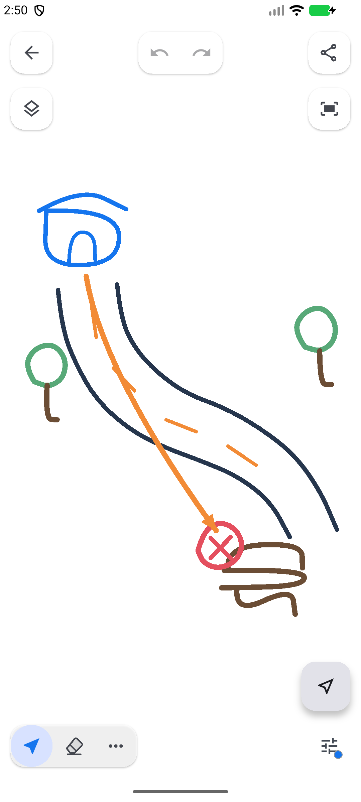
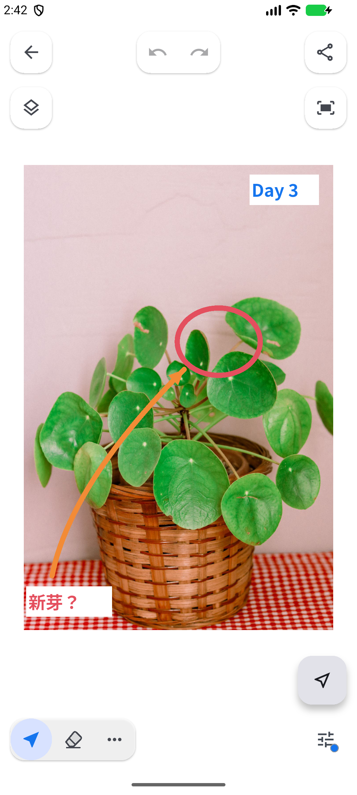
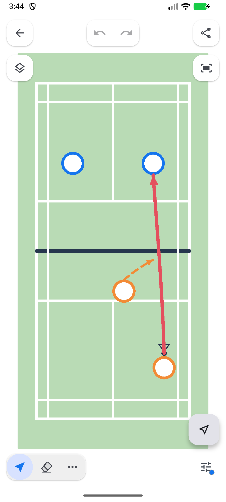
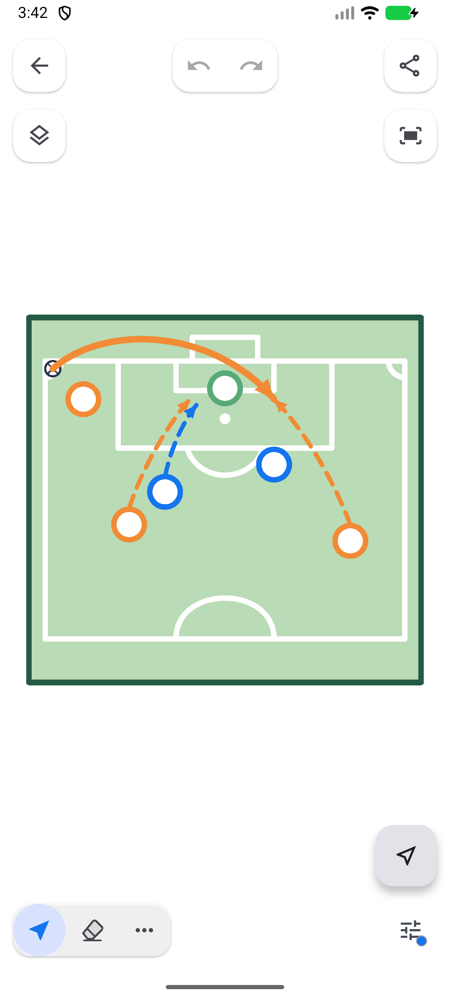
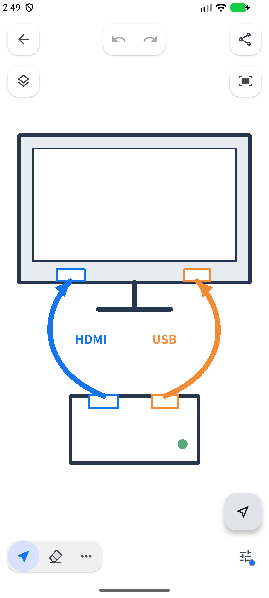

# TTDraw

**Quickly sketch an idea, refine it, and share it.**

[日本語](README.md) · [Downloads and release history](https://github.com/toyo-craft/ttdraw/releases)

TTDraw is a vector drawing app for Android. Verified, signed APKs are distributed through GitHub Releases as an early distribution channel until the app is available on Google Play.

## Features

- Draw with pen strokes, lines, Bezier curves, rectangles, circles, and text.
- Select, move, rotate, resize, flip, align, and group objects.
- Work with foreground and background layers, imported images and SVG, and reusable templates.
- Save, share, or copy the visible canvas area as PNG.
- Export and import all saved data in one TTD (`.ttd`, TTDraw) file.
- Switch between Japanese and English.

The current version is free. It has no account registration, ads, in-app payments, or automatic sketch uploads to the Provider's server. The app itself is not open-source, and its implementation source is not published.

## Get started

1. Review the latest release notes and APK on [Releases](https://github.com/toyo-craft/ttdraw/releases).
2. Follow [Installation and updates](docs/en/install.md). Android 7.0 (API24) or later is required.
3. Regularly back up important sketches using [Data and migration](docs/en/data.md).

**Up to 30 regular sketches are retained.** When the limit is exceeded, the oldest regular sketches by save date are automatically cleaned up. Favorites, templates, and unreadable saved entries are excluded. **PNG captures the currently visible canvas area**, not all content outside the viewport.

These are actual screens captured from the published 0.1.7 APK (build 8) running on an Android emulator. Both language versions use the same five images; click an image to open it at full size. Court and device drawings were prepared for these examples.

Photo: [Fadime Demirtaş / Pexels](https://www.pexels.com/photo/green-plant-on-a-woven-pot-10229948/).

## Guides and terms

- [Saved data and TTD](docs/en/data.md)
- [Known limitations](docs/en/known-issues.md)
- [Change notes](CHANGELOG.en.md)
- [Terms of use](docs/en/terms.md)
- [Privacy policy](docs/en/privacy.md)
- [Third-party licenses](docs/en/third-party-licenses.md)

This distribution provides the Android APK. The Privacy Policy also describes the verification Web version built from the same codebase; that Web version is not part of this public distribution.

## Reports and contact

Use [GitHub Issues](https://github.com/toyo-craft/ttdraw/issues) for reports and requests that can be public. Include the device, Android version, app version, and reproduction steps.

Send personal or confidential inquiries to **[info@toyo-craft.net](mailto:info@toyo-craft.net)**. Do not post private sketches or contact details in public issues.

Provider: Toyo Craft lab · Brand: TOYO CRAFT Laboratory&Co · [Official website](https://toyo-craft.net/)

© 2026 Toyo Craft lab
