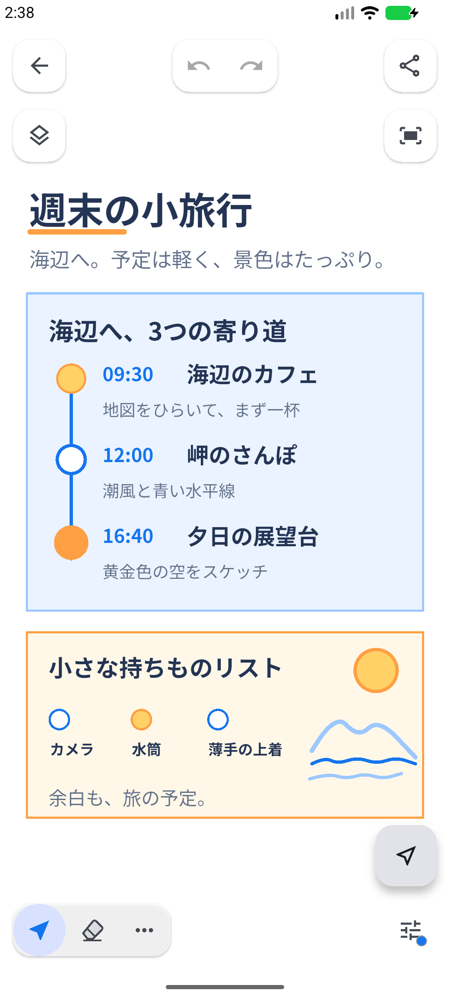

# TTDraw

**さっとアイデアを、スケッチして共有する。**

[English](README.en.md) · [ダウンロードと変更履歴](https://github.com/toyo-craft/ttdraw/releases)

TTDrawは、思いついたアイデアをすばやく描き、整え、共有するAndroid向けベクター描画アプリです。Google Play公開までの先行配布として、動作確認した署名付きAPKをGitHub Releasesから提供します。

## できること

- ペン、直線、曲線、長方形、円、文字でアイデアを描く。
- 選択、移動、回転、拡大縮小、反転、整列、グループ化で整える。
- 前景・背景の2層、画像・SVGの取込み、テンプレートを利用する。
- 表示中の範囲をPNGで保存・共有・クリップボードへコピーする。
- 全保存データをTTD（`.ttd`、TTDraw専用ファイル）でエクスポート／インポートする。
- 日本語・英語を切り替える。

現行版は無料で、アカウント登録・広告・アプリ内決済・提供者サーバーへのスケッチ自動送信はありません。本アプリ本体は非OSSで、実装ソースは公開していません。

## はじめる

1. [Releases](https://github.com/toyo-craft/ttdraw/releases)で、最新版の説明とAPKを確認してください。
2. [インストール・更新](docs/ja/install.md)に従って導入します。対応はAndroid 7.0（API24）以降です。
3. 重要なスケッチは[データの保存と移行](docs/ja/data.md)に従って定期的にバックアップしてください。

**通常スケッチは30件までです。** 上限を超えると更新日時の古い通常スケッチから自動整理されます。お気に入り・テンプレート・読込み不能データは対象外です。**PNGは現在表示しているキャンバス範囲の出力**で、画面外の全体出力ではありません。

画面画像は、公開版0.1.7（ビルド8）をAndroidエミュレーターで実行して撮影したものです。作例は、編集可能な文字・図形・線からなる専用ファイルをアプリの標準機能で取り込み、実際の編集画面で表示しています。画像へのUIの合成や文字の後付けは行っていません。

## 案内と利用条件

- [保存・TTDの取扱い](docs/ja/data.md)
- [既知の制限](docs/ja/known-issues.md)
- [変更案内](CHANGELOG.md)
- [利用規約](docs/ja/terms.md)
- [プライバシーポリシー](docs/ja/privacy.md)
- [第三者ライセンス](docs/ja/third-party-licenses.md)

今回一般提供するのはAndroid用APKです。プライバシーポリシーには同じコードの検証用Web版の取扱いも記載していますが、Web版の一般配布は行いません。

## 不具合・問い合わせ

公開できる不具合や改善要望は[GitHub Issues](https://github.com/toyo-craft/ttdraw/issues)へ。端末・Android版・アプリ版・再現手順を添えてください。

個人情報や機密情報を含む相談は **[info@toyo-craft.net](mailto:info@toyo-craft.net)** へお送りください。公開Issueへ私的なスケッチや連絡先を書かないでください。

提供者：東洋クラフトlab · ブランド：TOYO CRAFT Laboratory&Co · [公式サイト](https://toyo-craft.net/)

© 2026 東洋クラフトlab
